<div align="center">


<a href="https://git.io/typing-svg">
  
</a>

<br/>


<br/><br/>

**🌊 From port selection to route planning, weather analysis, vessel intelligence and quotation management — one intelligent platform.**

[🚀 Quick Start](#-quick-start) · [🧠 Architecture](#-ai-agent-architecture) · [✨ Features](#-key-features) · [🖥️ Screenshots](#%EF%B8%8F-screenshots) · [📈 Roadmap](#-roadmap)

</div>

---

## 🌐 Overview

**Waypoint AI** is a full-stack, AI-powered maritime brokerage platform that simplifies planning, evaluating and managing maritime transportation.

Traditional brokerage means collecting data from many disconnected sources. Waypoint AI unifies them into **one decision-support environment** built on a modular multi-agent backend (FastAPI) and a React + Vite frontend.

<div align="center">

| 🗺️ Routes | 🌦️ Weather | ⚓ Ports | 🚢 Vessels |
|:---:|:---:|:---:|:---:|
| Discover & compare | Risk & conditions | Connectivity | Profiles & AIS |

| 💰 Pricing | 🛃 Customs | 📄 Quotations | 🤖 AI Assistant |
|:---:|:---:|:---:|:---:|
| Freight & margin | Cargo analysis | Digital requests | Context-aware help |

</div>

---

## ✨ Key Features

<table>
<tr>
<td width="33%" valign="top">

### 🗺️ Route Intelligence
- Origin → destination search
- Route comparison & scoring
- Distance & transit-time analysis
- Transshipment analysis
- Recommended-route identification

</td>
<td width="33%" valign="top">

### 🌦️ Weather Intelligence
- Current conditions
- Wind, temperature, visibility
- Route weather risk
- Operational impact analysis

</td>
<td width="33%" valign="top">

### 🚢 Vessel & AIS
- Vessel profiles & types
- Capacity & operational data
- AIS service layer
- Vessel tracking & fleet awareness

</td>
</tr>
<tr>
<td valign="top">

### 💰 Pricing & Margin
- Base freight + distance
- Route-type & transshipment factors
- Margin analysis
- Route-level pricing

</td>
<td valign="top">

### 🛃 Customs
- Origin / destination checks
- Cargo-type analysis
- Container information

</td>
<td valign="top">

### 📄 Digital Quotations
- Company & contact details
- Cargo weight & containers
- Custom requirements
- Quote processing workflow

</td>
</tr>
<tr>
<td valign="top">

### 🤖 Waypoint AI Assistant
- Unified conversational layer
- Context-aware across modules
- Decision support

</td>
<td valign="top">

### 📊 Operations Dashboard
- Centralized operational view
- Analytics & charts
- Admin dashboard

</td>
<td valign="top">

### 🕘 History & 🔐 Auth
- Previous route/search history
- Registration, Login, Email OTP
- Password protection

</td>
</tr>
</table>

---

## 🧠 AI Agent Architecture

A modular agent-based design where each agent owns one maritime intelligence task, coordinated by a root agent.

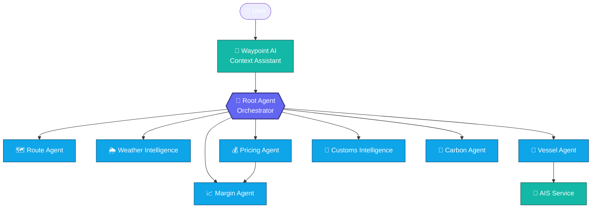

| Agent | Responsibility |
|---|---|
| 🤖 **AI Agent** | Context-aware AI assistance |
| 🌳 **Root Agent** | Coordinates all intelligence modules |
| 🗺️ **Route Agent** | Route discovery and analysis |
| 💰 **Pricing Agent** | Freight and route pricing |
| 📈 **Margin Agent** | Margin calculations |
| 🚢 **Vessel Agent** | Vessel intelligence |
| 🌱 **Carbon Agent** | Carbon-related analysis |
| 🛃 **Customs Intelligence** | Customs-related analysis |

---

## 🔄 End-to-End Workflow

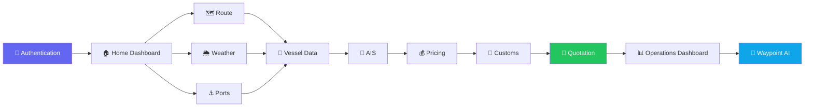

<details>
<summary><b>🗺️ Route Intelligence – data structure & flow</b></summary>
<br/>

| Field | Description |
|---|---|
| `route_id` | Unique route identifier |
| `origin` | Starting port |
| `destination` | Destination port |
| `distance_nm` | Distance in nautical miles |
| `transit_days` | Estimated transit duration |
| `transshipments` | Number of transshipments |
| `route_type` | Type/category of route |
| `base_freight_usd` | Base freight value |

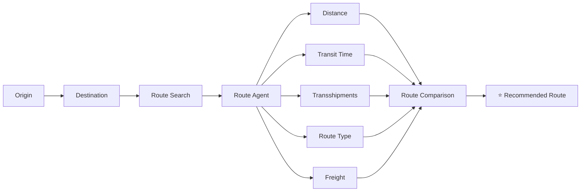

</details>

<details>
<summary><b>🌦️ Weather Intelligence – workflow</b></summary>
<br/>

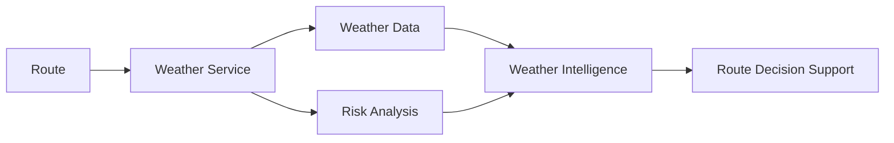

**Analysis includes:** current conditions · wind · temperature · visibility · weather risk · route conditions · operational impact

</details>

<details>
<summary><b>💰 Pricing & Freight – workflow</b></summary>
<br/>

| Parameter | Purpose |
|---|---|
| Base Freight | Starting freight value |
| Distance | Route distance |
| Route Type | Route classification |
| Transshipments | Additional route complexity |
| Transit Days | Estimated transportation duration |

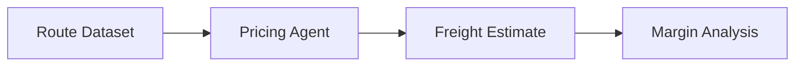

</details>

<details>
<summary><b>🛃 Customs & 📄 Quotation – workflow</b></summary>
<br/>

**Customs inputs:** Origin (e.g. Chennai) · Destination (e.g. Rotterdam) · Cargo type (e.g. Electronics) · Containers (e.g. 19)

**Quotation inputs:** Company name · Email · Phone · Cargo weight · Containers · Requirements

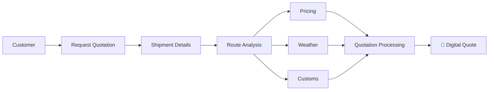

</details>

<details>
<summary><b>🔐 Authentication flow</b></summary>
<br/>

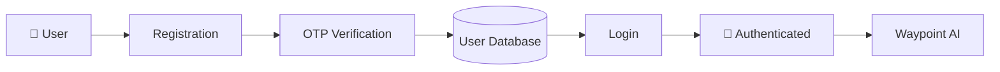

| Component | Purpose |
|---|---|
| Registration | Create user account |
| Login | Authenticate users |
| OTP | Email-based verification |
| Security | Password protection |
| Database | Store user information |

</details>

---

## 🛠️ Tech Stack

<div align="center">

| Layer | Technology |
|:---:|:---:|
| 🎨 Frontend |    |
| 🐍 Backend |   |
| 📊 Data |   |
| 🗄️ Database |  |
| 📧 OTP |  |
| 📡 Maritime | AIS / Vessel Services |
| 🔧 Tools |   |

</div>

---

## 🖥️ Screenshots

<div align="center">

| 🏠 Home | 🗺️ Route Analysis |
|:---:|:---:|
| 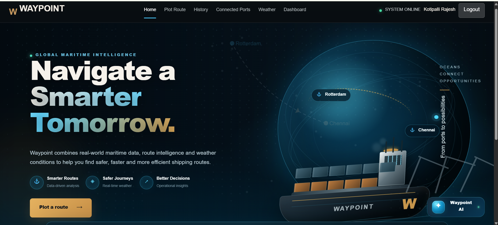 | 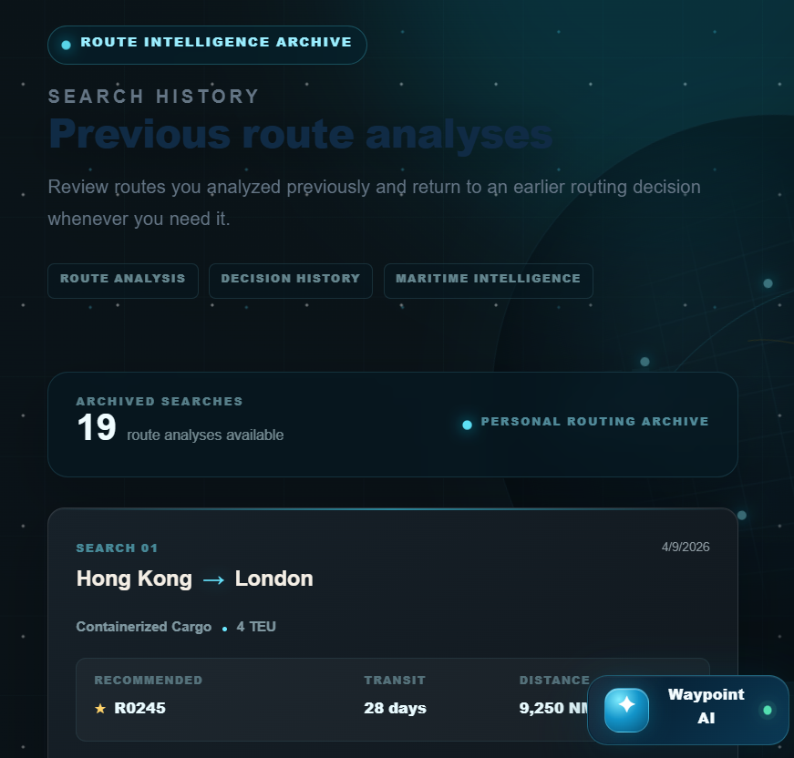 |

| 🌦️ Weather Intelligence | ⚓ Connected Ports |
|:---:|:---:|
| 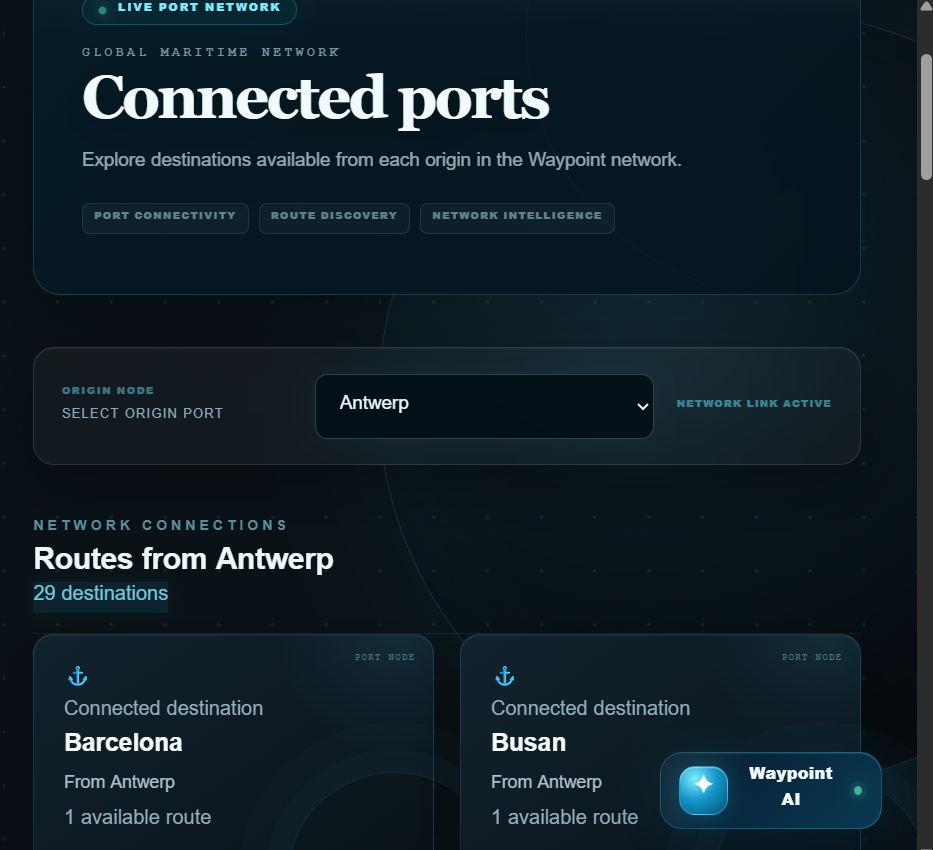 | 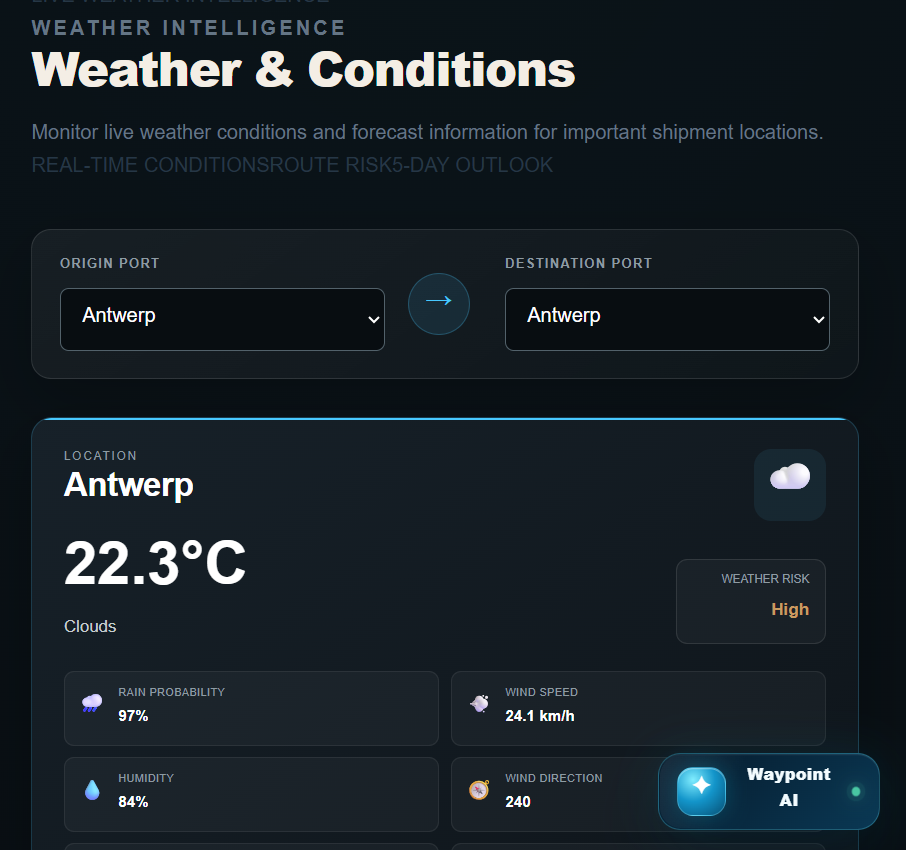 |

| 🕘 History | 🤖 Waypoint AI |
|:---:|:---:|
| 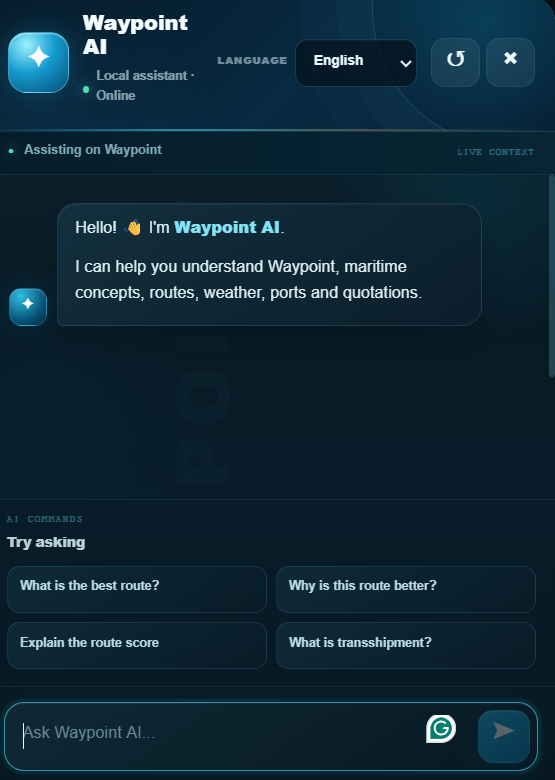 | 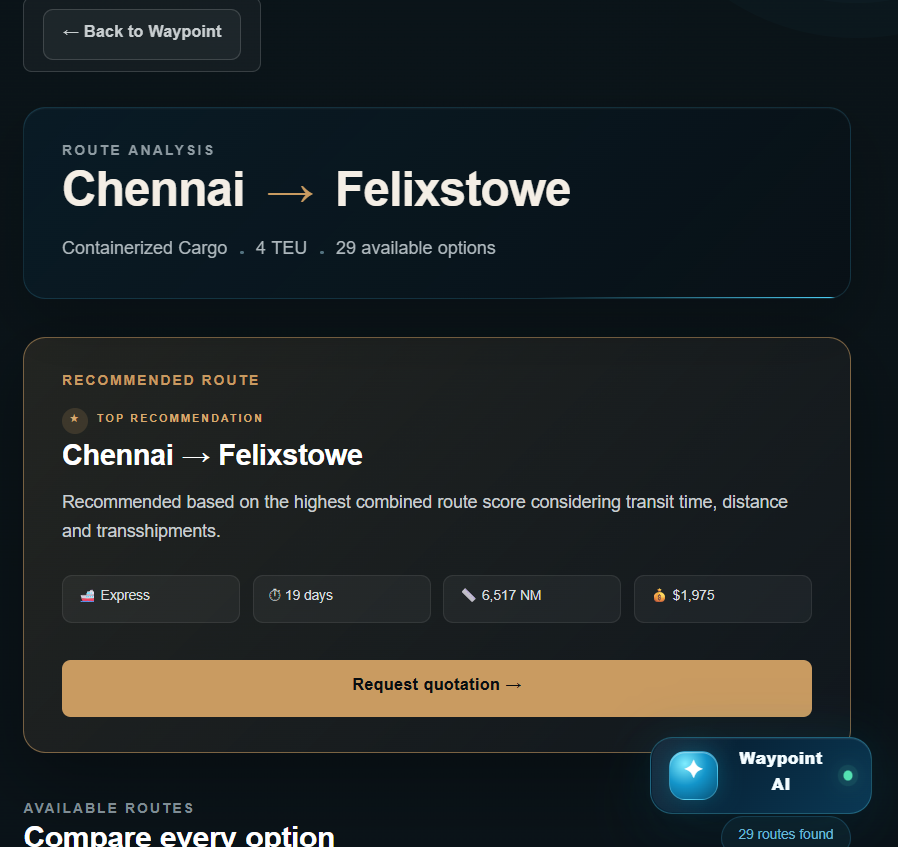 |

### 🏗️ System Architecture
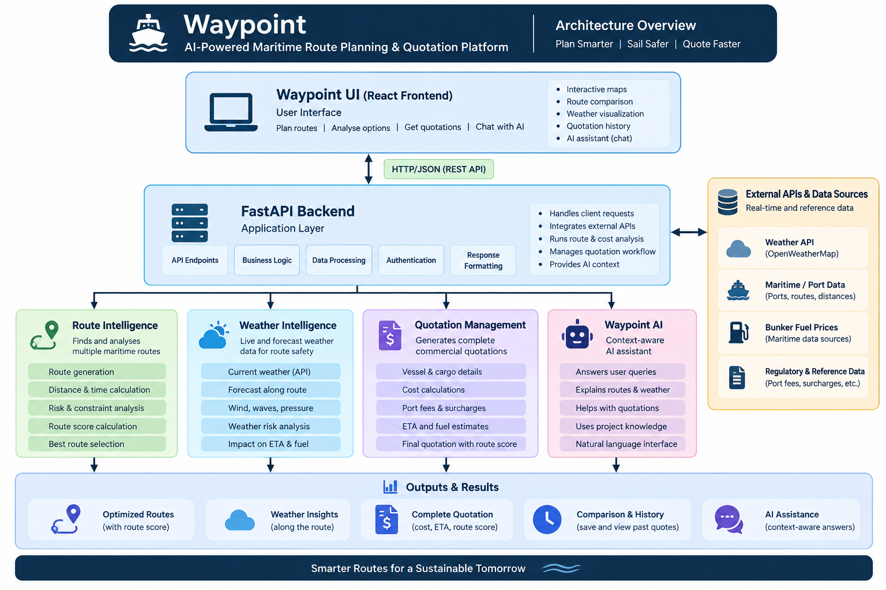

</div>

---

## 📋 Feature Matrix

| Feature | Backend | Frontend | Data / Service | Status |
|---|:---:|:---:|---|:---:|
| User Registration | ✅ | ✅ | SQLite | 🟢 Implemented |
| User Login | ✅ | ✅ | Authentication | 🟢 Implemented |
| OTP Verification | ✅ | ✅ | Email | 🟢 Implemented |
| Route Analysis | ✅ | ✅ | `routes.csv` | 🟢 Implemented |
| Route Comparison | ✅ | ✅ | Route Agent | 🟢 Implemented |
| Weather Intelligence | ✅ | ✅ | Weather Service | 🟢 Implemented |
| Connected Ports | ✅ | ✅ | Port Data | 🟢 Implemented |
| Pricing | ✅ | ✅ | `pricing.csv` | 🟢 Implemented |
| Margin Analysis | ✅ | ✅ | Margin Agent | 🟢 Implemented |
| Customs Analysis | ✅ | ✅ | Customs Intelligence | 🟢 Implemented |
| Vessel Intelligence | ✅ | ✅ | `vessel_profiles.csv` | 🟢 Implemented |
| AIS Service | ✅ | 🔄 | AIS Service | 🟡 Integrated |
| Quotations | ✅ | ✅ | Quotation Service | 🟢 Implemented |
| Search History | ✅ | ✅ | History Module | 🟢 Implemented |
| Reviews | ✅ | ✅ | Reviews Module | 🟢 Implemented |
| Operations Dashboard | ✅ | ✅ | Multiple Modules | 🟢 Implemented |
| Waypoint AI Assistant | ✅ | ✅ | AI Agent | 🟢 Implemented |

---

## 🚀 Quick Start

**Prerequisites:** Python 3.x · Node.js · npm · Git

### 1️⃣ Clone

```bash
git clone https://github.com/rajeshkotipalli/AI_MARITIME_BROKAGE.git
cd AI_MARITIME_BROKAGE
```

### 2️⃣ Backend (FastAPI)

```bash
cd backend
python -m venv .venv

# Windows
.venv\Scripts\Activate.ps1
# macOS / Linux
# source .venv/bin/activate

pip install -r requirements.txt
uvicorn main:app --reload
```

- API → http://127.0.0.1:8000
- Docs → http://127.0.0.1:8000/docs

### 3️⃣ Frontend (React + Vite)

```bash
cd frontend
npm install
npm run dev
```

Vite prints the local frontend URL in the terminal.

### 🔑 Environment Variables

Create a `.env` file in `backend/`:

```env
GMAIL_SENDER_EMAIL=your-email@example.com
GMAIL_APP_PASSWORD=your-app-password
```

> [!WARNING]
> Never commit `.env`, `.env.*`, `*.db`, `*.sqlite`, `*.sqlite3`. They are excluded via `.gitignore`.

---

## 🗂️ Project Structure

<details>
<summary><b>Click to expand</b></summary>

```text
waypointai_upgraded/
├── backend/
│   ├── app/
│   │   ├── agents/
│   │   │   ├── ai_agent.py
│   │   │   ├── carbon_agent.py
│   │   │   ├── margin_agent.py
│   │   │   ├── pricing_agent.py
│   │   │   ├── rootagent.py
│   │   │   ├── route_agent.py
│   │   │   └── vessel_agent.py
│   │   ├── data/
│   │   │   ├── pricing.csv
│   │   │   ├── routes.csv
│   │   │   └── vessel_profiles.csv
│   │   ├── services/
│   │   │   ├── ais_service.py
│   │   │   ├── carbon_service.py
│   │   │   └── quotation_service.py
│   │   ├── auth.py        ├── database.py
│   │   ├── history.py     ├── models.py
│   │   ├── otp.py         ├── quotation.py
│   │   └── reviews.py     └── security.py
│   ├── main.py
│   ├── test_ais_service.py
│   ├── test_aisstream.py
│   └── test_gemini.py
├── frontend/
│   ├── public/
│   ├── src/
│   │   ├── assets/  components/  pages/
│   │   ├── AdminDashboard.jsx  AdminLogin.jsx  AdminOTP.jsx
│   │   ├── App.jsx  ChartCanvas.jsx  Login.jsx
│   │   ├── OTPVerification.jsx  Register.jsx
│   │   └── index.css  main.jsx  translations.js
│   ├── package.json
│   └── vite.config.js
├── docs/Waypoint_Project_Presentation.pptx
├── screenshots/
├── assets/banner.svg
└── README.md
```

</details>

<details>
<summary><b>🧩 Core backend modules</b></summary>
<br/>

| Module | File | Responsibility |
|---|---|---|
| AI Agent | `ai_agent.py` | AI assistance |
| Root Agent | `rootagent.py` | Agent orchestration |
| Route Agent | `route_agent.py` | Route analysis |
| Pricing Agent | `pricing_agent.py` | Freight pricing |
| Margin Agent | `margin_agent.py` | Margin calculations |
| Vessel Agent | `vessel_agent.py` | Vessel intelligence |
| Carbon Agent | `carbon_agent.py` | Carbon analysis |
| AIS Service | `ais_service.py` | AIS integration |
| Quotation Service | `quotation_service.py` | Quotation processing |
| Auth / Security / OTP | `auth.py`, `security.py`, `otp.py` | Authentication |
| Database / Models | `database.py`, `models.py` | Persistence |
| History / Reviews | `history.py`, `reviews.py` | Activity & feedback |

</details>

<details>
<summary><b>📦 Datasets</b></summary>
<br/>

| Dataset | Location | Purpose |
|---|---|---|
| Routes | `backend/app/data/routes.csv` | Maritime route information |
| Pricing | `backend/app/data/pricing.csv` | Freight / pricing information |
| Vessel Profiles | `backend/app/data/vessel_profiles.csv` | Vessel information |

</details>

---

## 🧪 Testing

```text
backend/
├── test_ais_service.py
├── test_aisstream.py
└── test_gemini.py
```

Run them with your configured Python testing environment (e.g. `pytest`).

---

## 🔒 Security Practices

- 🔐 Never commit API keys, email passwords or database files
- 🔄 Rotate any exposed credentials
- 🛡️ Validate user input
- 🔒 Use HTTPS in production
- 🔑 Use secure authentication mechanisms

---

## 📈 Roadmap

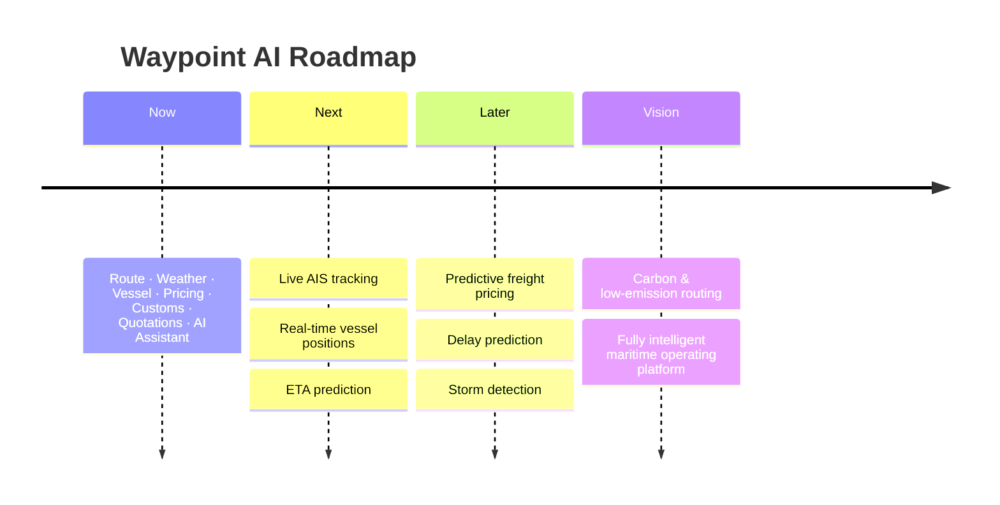

<details>
<summary><b>See the full enhancement list</b></summary>
<br/>

- 🌐 **Real-time intelligence:** live AIS, fleet monitoring, port congestion, traffic visualization
- 🧠 **Advanced AI:** route optimization, predictive pricing, delay prediction, document processing, broker recommendations
- 🌦️ **Predictive weather:** forecasting, storm detection, route risk prediction, weather-based ETA
- 💰 **Commercial:** dynamic pricing, automated quotes, profitability prediction, margin optimization
- 🌱 **Sustainability:** carbon estimation, low-emission routes, fuel optimization

</details>

---

## 🎯 Why Waypoint AI?

| Traditional Maritime Workflow | ⚓ Waypoint AI |
|---|---|
| Multiple information sources | Unified platform |
| Manual route comparison | Route intelligence |
| Separate weather checking | Integrated weather intelligence |
| Manual vessel research | Vessel intelligence |
| Manual freight calculations | Pricing intelligence |
| Separate customs analysis | Customs intelligence |
| Manual quotation workflow | Digital quotations |
| Limited historical visibility | Search history |
| Fragmented operational data | Operations dashboard |
| Static workflow | AI-assisted workflow |

---

## 📜 License

This project is currently maintained as a development and academic engineering project. License and contribution terms can be added when it moves toward public production use.

<div align="center">

<br/>

**🚢 WAYPOINT AI**
*Navigate Smarter. Decide Faster. Operate Better.*


</div>
